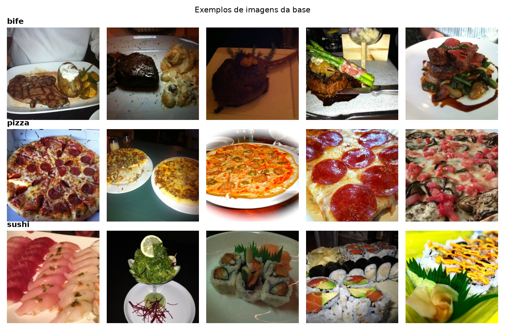
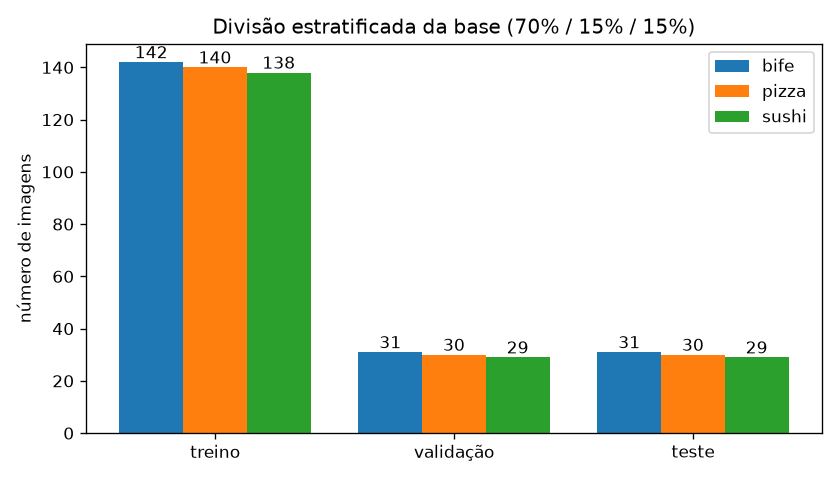
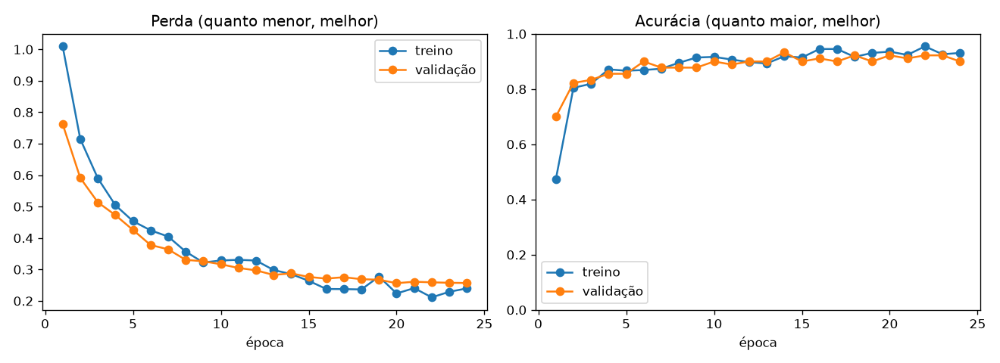
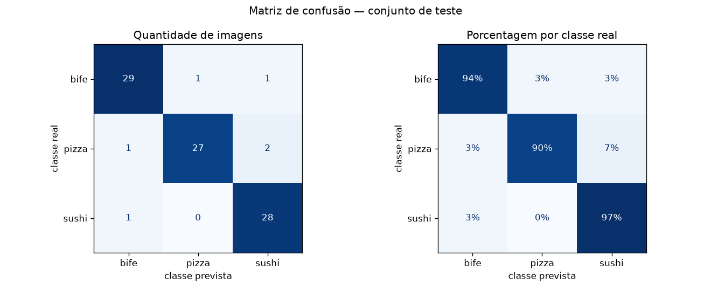
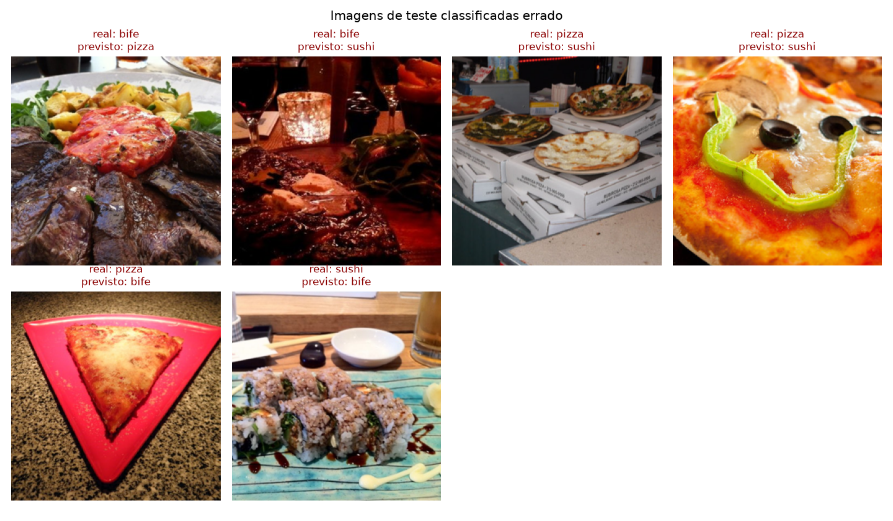

# PjBL2 — Classificação de imagens de comida com visão computacional

**Disciplina:** Sistemas de Informação Inteligentes — Prof. Dr. Joelton Deonei Gotz (PUCPR)

**Integrantes:** Carlos Hobmeier, Amanda Queiroz e João Vitor de Freitas

Modelo de visão computacional que classifica fotos de comida em **3 categorias**:
**bife**, **pizza** e **sushi**.

> 📄 **Relatório visual:** abra o [relatorio.html](relatorio.html) no navegador para ver o projeto
> explicado passo a passo, com gráficos interativos e a matriz de confusão.



---

## Como cada exigência do enunciado foi atendida

| # | Exigência | Arquivo | O que foi feito |
|---|-----------|---------|-----------------|
| 1 | Base de imagens com 3 categorias | [etapa1_obter_dataset.py](etapa1_obter_dataset.py) | 600 fotos reais (≈200 por classe), subconjunto do dataset público Food-101 |
| 2 | Protocolo experimental: treino, validação e teste | [etapa2_dividir_dataset.py](etapa2_dividir_dataset.py) | Divisão *holdout* estratificada 70% / 15% / 15% com semente fixa |
| 3 | Modelo de visão computacional | [etapa3_treinar_modelo.py](etapa3_treinar_modelo.py) | CNN ResNet-18 pré-treinada no ImageNet (*transfer learning*) |
| 4 | Matriz de confusão e métricas | [etapa4_avaliar_modelo.py](etapa4_avaliar_modelo.py) | Matriz de confusão, acurácia, precisão, revocação, especificidade e F1 |

---

## Como executar

Requer Python 3.10 ou mais recente.

```bash
python3 -m venv .venv
```

```bash
source .venv/bin/activate
```

```bash
pip install -r requirements.txt
```

```bash
python3 executar_tudo.py
```

O `executar_tudo.py` roda as 4 etapas em sequência (≈1 minuto com GPU, alguns minutos só com CPU).
Cada etapa também pode ser executada separadamente, por exemplo `python3 etapa3_treinar_modelo.py`.

Todos os parâmetros (proporções da divisão, número de épocas, taxa de aprendizado, semente…)
ficam em [config.py](config.py).

---

## Estrutura do projeto

```
pjbl2/
├── config.py                  ← todos os parâmetros ajustáveis
├── etapa1_obter_dataset.py    ← 1. baixa e organiza a base de imagens
├── etapa2_dividir_dataset.py  ← 2. divide em treino / validação / teste
├── etapa3_treinar_modelo.py   ← 3. treina a ResNet-18
├── etapa4_avaliar_modelo.py   ← 4. matriz de confusão e métricas
├── executar_tudo.py           ← roda as 4 etapas em ordem
├── utils/
│   ├── dados.py               ← leitura das imagens e transformações
│   ├── modelo.py              ← criação, salvamento e carregamento do modelo
│   └── graficos.py            ← geração das figuras
├── dados/                     ← (gerado) imagens originais e divididas
└── resultados/                ← (gerado) figuras, métricas e modelo treinado
```

---

## Etapa 1 — Base de imagens

Foi usado um subconjunto do **Food-101** (Bossard et al., 2014), uma base pública de fotos
de pratos tiradas por pessoas comuns: iluminação, ângulo e fundo variam bastante, o que torna
o problema realista.

| Classe | Imagens |
|--------|--------:|
| bife   | 204 |
| pizza  | 200 |
| sushi  | 196 |
| **total** | **600** |

O arquivo baixado já vinha dividido em treino e teste, mas **juntamos tudo** em
`dados/originais/<classe>/` para que a divisão fosse feita pelo nosso próprio protocolo (Etapa 2).

> **Usar outra base:** basta colocar as imagens em `dados/originais/<nome_da_classe>/`
> (uma pasta por classe) e rodar a partir da Etapa 2. O código não depende de quais são as classes.

## Etapa 2 — Protocolo experimental

Divisão **holdout estratificada**:

| Conjunto | Proporção | Para que serve |
|----------|----------:|----------------|
| Treino    | 70% | Ajustar os pesos do modelo |
| Validação | 15% | Escolher a melhor época e decidir quando parar o treino |
| Teste     | 15% | Medir o desempenho final, **usado uma única vez** |

- **Estratificada:** cada conjunto mantém a mesma proporção entre as classes da base completa.
- **Semente fixa (`SEMENTE = 42`):** a divisão é sempre a mesma, então os resultados são reproduzíveis.
- **Teste isolado:** o modelo nunca vê as imagens de teste durante o treino nem na escolha do
  melhor modelo, evitando uma avaliação otimista.



## Etapa 3 — Modelo

**ResNet-18 com *transfer learning*:**

1. A ResNet-18 é uma rede neural convolucional (CNN) já treinada no ImageNet
   (1,2 milhão de imagens, 1000 categorias). Suas camadas já sabem extrair bordas, texturas e formas.
2. Essas camadas foram **congeladas** (seus pesos não mudam).
3. A última camada, que classificava 1000 classes, foi **trocada por uma nova com 3 saídas**
   (bife, pizza, sushi). Só ela é treinada.

Por que essa abordagem: com apenas 420 imagens de treino, treinar uma CNN do zero levaria a
*overfitting* (o modelo decoraria as imagens). Reaproveitar uma rede pré-treinada exige
pouquíssimos dados e pouco tempo de treino.

**Detalhes do treinamento**

| Item | Valor |
|------|-------|
| Função de perda | Entropia cruzada (`CrossEntropyLoss`) |
| Otimizador | Adam, taxa de aprendizado 0,001 |
| Tamanho do lote | 32 imagens |
| Épocas | até 25, com **parada antecipada** após 4 épocas sem melhora na validação |
| *Data augmentation* (só no treino) | recorte aleatório e espelhamento horizontal |
| Critério para salvar o modelo | menor perda no conjunto de validação |



As curvas de treino e validação ficam próximas durante todo o treinamento, indicando que o modelo
**não sofreu overfitting**.

## Etapa 4 — Resultados no conjunto de teste



| Classe | Precisão | Revocação | Especificidade | F1-score | Imagens |
|--------|---------:|----------:|---------------:|---------:|--------:|
| bife   | 0,935 | 0,935 | 0,966 | 0,935 | 31 |
| pizza  | 0,964 | 0,900 | 0,983 | 0,931 | 30 |
| sushi  | 0,903 | 0,966 | 0,951 | 0,933 | 29 |
| **média macro** | **0,934** | **0,934** | **0,967** | **0,933** | **90** |

**Acurácia: 93,3%** (84 de 90 imagens de teste classificadas corretamente).

> Os números podem variar um pouco em outro computador (CPU × GPU), mesmo com a semente fixa.

### O que cada métrica significa

Para uma classe C (por exemplo, "pizza"):

| Métrica | Fórmula | Pergunta que responde |
|---------|---------|-----------------------|
| **Precisão** | VP / (VP + FP) | Quando o modelo diz "pizza", com que frequência acerta? |
| **Revocação** (sensibilidade, *recall*) | VP / (VP + FN) | De todas as pizzas, quantas o modelo encontrou? |
| **Especificidade** | VN / (VN + FP) | Do que não é pizza, quanto o modelo corretamente *não* chamou de pizza? |
| **F1-score** | 2 · P · R / (P + R) | Equilíbrio entre precisão e revocação |
| **Acurácia** | acertos / total | Percentual geral de acertos |

VP = verdadeiros positivos, FP = falsos positivos, FN = falsos negativos, VN = verdadeiros negativos.

### Análise dos erros



Os erros acontecem principalmente em fotos **escuras**, com **vários alimentos no mesmo prato**
ou com **enquadramentos incomuns** (muito próximas do alimento ou com vários pratos ao fundo).
A pizza teve a menor revocação (90%): duas pizzas foram confundidas com sushi.

---

## Arquivos gerados em `resultados/`

| Arquivo | Conteúdo |
|---------|----------|
| `1_amostras_do_dataset.png` | Exemplos de imagens de cada classe |
| `2_divisao_do_dataset.png` | Quantidade de imagens por classe em cada conjunto |
| `3_curvas_de_treinamento.png` | Perda e acurácia por época (treino × validação) |
| `4_matriz_de_confusao.png` | Matriz de confusão em quantidade e porcentagem |
| `4_metricas.txt` | Tabela de métricas por classe |
| `4_erros_de_classificacao.png` | Imagens de teste classificadas errado |
| `historico_treinamento.json` | Perda e acurácia de cada época |
| `modelo_treinado.pt` | Pesos do melhor modelo (não vai para o GitHub; é recriado ao rodar o projeto) |

## Referências

- Bossard, L.; Guillaumin, M.; Van Gool, L. *Food-101 – Mining Discriminative Components with Random Forests.* ECCV, 2014.
- He, K. et al. *Deep Residual Learning for Image Recognition.* CVPR, 2016.
- Subconjunto pizza/bife/sushi disponibilizado em [mrdbourke/pytorch-deep-learning](https://github.com/mrdbourke/pytorch-deep-learning).
